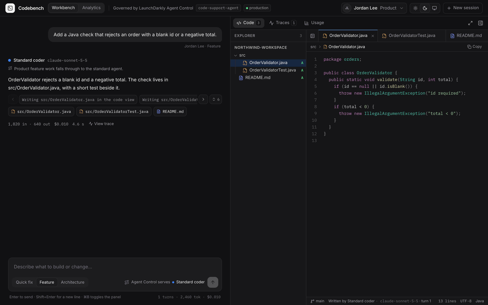
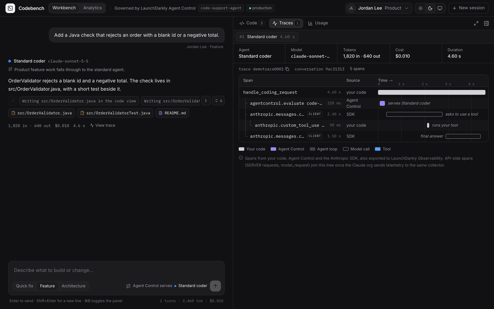
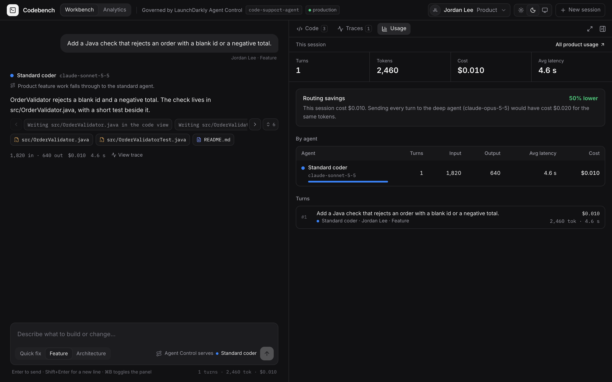
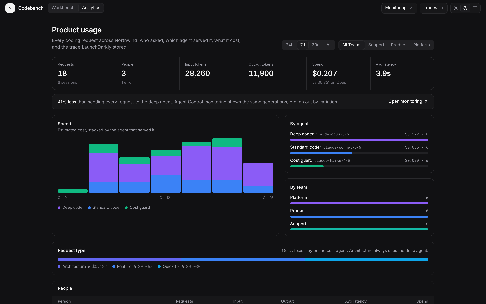

# Codebench

Codebench is a solutions-engineering demo of [LaunchDarkly Agent Control](https://launchdarkly.com/). Someone describes a coding task in plain language. Agent Control chooses which Claude model should do the work, the agent builds the project in the browser, and the turn’s OpenTelemetry trace, tokens, and cost stay next to the chat.

The LaunchDarkly project is `CT_Agent_Control_Claude`. The AI Config is `code-support-agent`, served from the `production` environment.

## Workbench

The chat is on the left. The person and the request type decide which agent is previewed before the message is sent. The reply names the agent Agent Control actually served, and the files it wrote open in the code view.

Long tool runs stay on one row. Arrows move through the chips, and the count expands or shrinks the list. While a file is still being written, the editor updates in place and the chat says the file is being written in the code view.



## Traces

Each turn records a span tree: the harness, the Agent Control evaluation, the model calls, and the tools. The waterfall follows the Claude OpenTelemetry layout, with source, kind, and timing. Spans are also exported to LaunchDarkly Observability.



## Usage

The Usage tab is the current session: tokens, estimated cost, latency, and how that compares with sending every turn to the deep agent.



## Product analytics

Analytics rolls up every request stored on this machine: people, teams, models, request types, spend, and errors. **Monitoring** and **Traces** open the same generations in LaunchDarkly.

The ledger is a local file, `data/usage.jsonl`. It is gitignored. The screenshot below is sample traffic, not a customer export.



## How a request is routed

Agent Control evaluates `code-support-agent` with the person and the request type. The demo mirrors these rules:

| Request | Who | Agent | Model |
| --- | --- | --- | --- |
| Quick fix | Any team | Cost guard | Claude Haiku |
| Architecture | Any team | Deep coder | Claude Opus |
| Feature | Support | Cost guard | Claude Haiku |
| Feature | Platform | Deep coder | Claude Opus |
| Feature | Product | Standard coder | Claude Sonnet |

The people in the picker are Sam Ortiz (support), Jordan Lee (product), and Maya Chen (platform). Their addresses are example addresses, not real accounts.

The agent can write project files and read a public GitHub repository. Code in the editor is syntax-colored for the common languages, including Java, TypeScript, Python, Go, and Rust.

## Run it

```bash
npm install
cp .env.example .env.local
npm run dev
```

Open [http://localhost:3000](http://localhost:3000). Analytics is at `/analytics`.

Put the secrets in `.env.local` only. That file is gitignored. `.env.example` lists the names and leaves the secret values empty.

| Variable | Purpose |
| --- | --- |
| `LD_SDK_KEY` | LaunchDarkly server SDK key for this project |
| `ANTHROPIC_API_KEY` | Claude API key used by the coding agent |
| `LD_SERVICE_NAME` | Service name on the exported traces. Default `code-support-harness` |
| `LD_ENVIRONMENT` | LaunchDarkly environment. Default `production` |
| `LD_PROJECT_KEY` | Project key. Default `CT_Agent_Control_Claude` |
| `LD_CONFIG_KEY` | AI Config key. Default `code-support-agent` |

API-side spans (the model’s own server spans) appear after a Claude Console telemetry destination is pointed at the same LaunchDarkly collector. The harness still records its own spans without that.

## What is not in this repo

`.env`, `.env.local`, `node_modules`, `.next`, and `data/` are ignored. Do not commit SDK keys, API keys, or the usage ledger.
